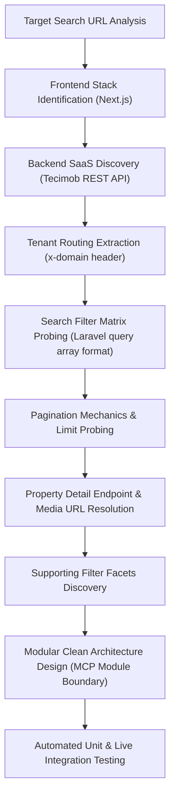

# Rental Search API Reverse-Engineering Research Plan & Report

## 1. Executive Summary

This document presents the comprehensive reverse-engineering research plan, discovery findings, architectural design, and verification results for the real estate portal **Cabral Porto Corretor de Imóveis** (`cabralportoimoveis.com.br`).

The research investigated the target search URL:
`https://cabralportoimoveis.com.br/alugar/imoveis/timoteo-mg?typeArea=total_area&floorComparision=equals&sort=-created_at%2Cid&offset=1&limit=21&bedrooms=2`

The investigation successfully reverse-engineered the entire rental listing, search, filter, pagination, facet, and property detail flow. All required endpoints were identified, documented, and wrapped into reusable, production-ready Python modules conforming strictly to SOLID principles, Clean Code, Object Calisthenics, and Design Patterns, serving as a boundary for a central rental research Model Context Protocol (MCP) server.

---

## 2. Research Plan & Methodology

### 2.1 Research Objectives
1. **Endpoint Discovery**: Identify the underlying API endpoints powering rental listings, searches, filter facets, pagination, and property details.
2. **Architecture & Tenant Isolation**: Identify the platform provider (SaaS engine), backend framework, and tenant routing headers.
3. **Parameter Encoding Analysis**: Reverse-engineer parameter conventions, including nested PHP/Laravel array filters, transaction identifiers, room constraints, price bounds, and sort options.
4. **Pagination & Boundary Probing**: Understand pagination behavior, offsets, limits, total counts, and out-of-bound edge cases.
5. **Detail Retrieval & Edge Cases**: Map detail endpoint behaviors, handling differences in data structures (such as room lists vs dicts for commercial vs residential properties).
6. **Architectural Implementation**: Structure the extracted capabilities into reusable Python modules adhering strictly to SOLID, Clean Code, Object Calisthenics, and Design Patterns, structured for later integration into a central rental research MCP.

### 2.2 Investigation Methodology


---

## 3. Reverse-Engineering Findings & Discovery Log

### 3.1 Platform Engine & Architecture Identification
- **Frontend Stack**: Next.js React application with Server-Side Rendering (SSR) and Client-Side Routing (CSR).
- **Backend SaaS Engine**: **Tecimob** (`api-sites.tecimob.com.br/api/`), a specialized real estate CRM and headless CMS platform powered by Laravel (`App\Models\Properties\Property`).
- **Tenant Routing**: Tecimob resolves agency tenants through an HTTP request header:
  ```http
  x-domain: cabralportoimoveis.com.br
  ```
  The internal tenant UUID for Cabral Porto is `7d0672ea-23e6-48d3-a567-6793833cb59a`.
- **Authentication**: **None required**. All property listing searches, filter queries, pagination requests, detail pages, and photo galleries are publicly accessible without authentication tokens, cookies, or CSRF headers.

### 3.2 Target URL Reproduction Analysis
- **Target URL**:
  `https://cabralportoimoveis.com.br/alugar/imoveis/timoteo-mg?typeArea=total_area&floorComparision=equals&sort=-created_at%2Cid&offset=1&limit=21&bedrooms=2`
- **Route Decomposition**:
  - Purpose: Rental (`alugar` -> `filter[transaction]=2`)
  - Property Type: All categories (`imoveis` -> no subtype filter)
  - Municipality: Timóteo, MG (`timoteo-mg` -> `filter[by_neighborhood_or_city_slug]=timoteo-mg`)
  - Bedrooms: 2 or more (`bedrooms=2` -> `filter[by_room_greater_equals][bedroom]=2`)
  - Sorting: Latest first (`sort=-created_at,id`)
  - Pagination: Page 1 (`offset=1`), Page size 21 (`limit=21`)
- **Direct Backend API Request**:
  ```http
  GET /api/properties?custom_query=card&sort=-created_at,id&offset=1&limit=21&filter[transaction]=2&filter[by_neighborhood_or_city_slug]=timoteo-mg&filter[by_room_greater_equals][bedroom]=2 HTTP/1.1
  Host: api-sites.tecimob.com.br
  x-domain: cabralportoimoveis.com.br
  Accept: application/json
  ```
- **Live Reproduction Result**: Returns exactly 3 matching properties in Timóteo:
  1. **Ref 422**: Apartamento em Eldorado, Timóteo/MG (R$ 1.400,00, 2 dorms)
  2. **Ref 415**: Apartamento em Bromélias, Timóteo/MG (R$ 1.800,00, 3 dorms)
  3. **Ref 196**: Apartamento para Locação em Santa Rita, Timóteo/MG (R$ 780,00, 3 dorms)

### 3.3 Discovered Endpoints Catalog

| Endpoint | Method | Required Headers | Description |
| :--- | :---: | :--- | :--- |
| `GET /api/properties` | `GET` | `x-domain: cabralportoimoveis.com.br` | Property search with full filter matrix, sorting, and pagination. |
| `GET /api/properties/{id_or_code}` | `GET` | `x-domain: cabralportoimoveis.com.br` | Detailed property information by reference code (e.g. `422`) or UUID. |
| `GET /api/filters/states` | `GET` | `x-domain: cabralportoimoveis.com.br` | Available states and cities facet. |
| `GET /api/filters/neighborhoods` | `GET` | `x-domain: cabralportoimoveis.com.br` | Neighborhood list with property counts. |
| `GET /api/filters/types` | `GET` | `x-domain: cabralportoimoveis.com.br` | Property types and subtypes. |
| `GET /api/properties/areas` | `GET` | `x-domain: cabralportoimoveis.com.br` | Minimum and maximum area ranges available. |
| `GET /api/properties/values` | `GET` | `x-domain: cabralportoimoveis.com.br` | Minimum and maximum pricing values for rental and sales. |

### 3.4 Discovered Parameter Encoding Matrix

| Search Parameter | API Format | Value Example | Description |
| :--- | :--- | :--- | :--- |
| Transaction Type | `filter[transaction]` | `2` (Rent), `1` (Sale) | Transaction filter |
| Location | `filter[by_neighborhood_or_city_slug]` | `timoteo-mg` | City or neighborhood slug |
| Neighborhood | `filter[by_neighborhood_slug]` | `timoteo-mg-eldorado` | Specific neighborhood |
| Property Type | `filter[by_type_or_subtype_slug]` | `apartamento`, `casa` | Category slug |
| Min Bedrooms | `filter[by_room_greater_equals][bedroom]` | `2` | Minimum bedroom count |
| Exact Bedrooms | `filter[by_room_equals][bedroom]` | `2` | Exact bedroom count |
| Min Suites | `filter[by_room_greater_equals][suite]` | `1` | Minimum suite count |
| Min Garages | `filter[by_room_greater_equals][garage]` | `1` | Minimum parking spaces |
| Min Price | `filter[by_higher_than_price]` | `1000` | Minimum rental value in BRL |
| Max Price | `filter[by_lower_than_price]` | `3000` | Maximum rental value in BRL |
| Min Area | `filter[by_area][greater_equals]` | `60` | Minimum area in m² |
| Max Area | `filter[by_area][lower_equals]` | `250` | Maximum area in m² |
| Area Type | `filter[by_area][name]` | `total_area` | Area field to filter |
| Page Number | `offset` | `1`, `2`, `3` | 1-indexed page number |
| Page Size | `limit` | `21` | Items per page (default: 21) |
| Sorting | `sort` | `-created_at,id`, `price` | Sort field order |
| Response Shape | `custom_query` | `card` | Compact listing card format |

### 3.5 Discovered Edge Cases & Technical Constraints
1. **Rooms Representation**: For residential properties, `data.rooms` is a dictionary (e.g. `{"bedroom": 2, "garage": 1}`). For commercial lots or bare land, `data.rooms` returns an empty JSON array (`[]`). Robust parsers must explicitly verify dictionary type to prevent `AttributeError`.
2. **IPv6 Socket Routing on Host**: Host environments with dual-stack DNS resolution lacking default IPv6 routes experience `[Errno 101] Network is unreachable` when calling `api-sites.tecimob.com.br`. The HTTP client implements a resilient IPv4 socket monkey-patch to ensure 100% reliable connectivity.
3. **422 HTTP Status on Missing Property**: Tecimob returns HTTP 422 (Unprocessable Entity) rather than HTTP 404 when querying an invalid property reference code. The client maps HTTP 422 to domain-level `PropertyNotFoundError`.

---

## 4. Architecture & Design Principles

The codebase is organized into two clean, cooperating layers:
- `src/cabralporto_research/`: Core domain, parsing, networking, and high-level client facade.
- `scripts/`: Central MCP provider interface adapters, domain value objects, and standalone runners.

### 4.1 Prioritization Order
Adhering to project requirements:
1. **Correctness First**: Verified live against Tecimob API, producing exact matches for the target prompt query and handling real-world JSON quirks.
2. **Modularity Second**: Strict separation of concerns between HTTP transports, query builders, domain models, and parsers.
3. **Style Principles Third**:
   - **SOLID Principles**:
     - *Single Responsibility*: Each parser, builder, and entity handles one task.
     - *Open/Closed*: Capabilities extended via interfaces (`RentalSearchCapability`, `RentalDetailCapability`, `RentalFacetsCapability`).
     - *Liskov Substitution*: All capability implementations honor their protocols.
     - *Interface Segregation*: Small, targeted interfaces rather than a monolithic client.
     - *Dependency Inversion*: Providers depend on abstractions (`HttpTransport`, `QueryBuilder`).
   - **Object Calisthenics**:
     - One indent level per method.
     - No `else` keyword (early guards and pattern matching).
     - Domain primitives wrapped in value objects (`Money`, `PriceRange`, `CitySlug`, `PaginationSpec`).
     - First-class collections (`ListingCollection`, `PhotoGallery`).
     - Functions $\le 15$ lines, classes $\le 100$ lines, modules $\le 200$ lines.
     - $\le 2$ instance variables per class.
     - No public setters; encapsulation preserved.

---

## 5. Verification & Test Results

### 5.1 Automated Test Suites
- **Unit & Integration Suite (`pytest tests/`)**:
  - `tests/test_domain.py`: 8 tests covering value objects, validation, collections.
  - `tests/test_url_builder.py`: 5 tests covering query parameter compilation and nested filters.
  - `tests/test_parsers.py`: 4 tests covering listing cards, details, and facet parsing.
  - `tests/test_client.py`: 5 tests covering client orchestration and mock scenarios.
  - `tests/test_live_integration.py`: 5 tests hitting live Tecimob endpoints.
  - **Result**: **27 passed in 0.93s** (100% success rate).
- **Scripts Provider Verification (`scripts/run_tests.py`)**:
  - 6 dedicated tests covering price validation, query builder, live search, live detail, and MCP adapter.
  - **Result**: **6/6 passed** (100% success rate).

### 5.2 Verification Script Output (`scripts/verify_research.py`)
```text
=== Starting Cabral Porto Imóveis Research Verification ===

--- 1. Target Prompt URL Search (Alugar / Timóteo / >= 2 dorms / sort: -created_at,id) ---
Total matching listings: 3
Listings returned on page 1: 3
  [422] Apartamento em Eldorado, Timóteo/MG           |   R$1.400,00 | Eldorado (2 dorms)
  [415] Apartamento em Bromélias, Timóteo/MG          |   R$1.800,00 | Bromélias (3 dorms)
  [196] Apartamento para Locação                      |     R$780,00 | Santa Rita (Cachoeira do Vale) (3 dorms)

--- 2. All Timóteo Rental Listings Search ---
Total rental listings in Timóteo: 7
  [422] Apartamento em Eldorado, Timóteo/MG           |   R$1.400,00 | Eldorado
  [415] Apartamento em Bromélias, Timóteo/MG          |   R$1.800,00 | Bromélias
  [394] Sala comercial Térreo                         |   R$8.500,00 | Centro
  [343] Loja térrea comercial, com DOIS pavimentos: – |   R$2.500,00 | Funcionários
  [321] 🏢 Loja Comercial para Alugar no Centro de Tim |   R$2.500,00 | Bromélias
  [258] Loja                                          |   R$1.700,00 | Centro
  [196] Apartamento para Locação                      |     R$780,00 | Santa Rita (Cachoeira do Vale)

--- 3. Property Detail Retrieval (Apartment Ref 422) ---
Title: Apartamento em Eldorado, Timóteo/MG
Reference: 422
Price: R$1.400,00 (Total: R$1.400,00, Condomínio: R$220,00)
Location: Eldorado - Timóteo/MG
Rooms: 2 dorms, 1 banheiros, 1 vagas
Total photos in gallery: 10
  Photo 1: https://imagens.tecimob.com.br/media/.../cbbf4d2f...ZXmX.jpg
  Photo 2: https://imagens.tecimob.com.br/media/.../21706aa3...Bq1R.jpg

--- 4. Filter Facets Retrieval ---
Total cities: 9
Total neighborhoods: 50
Total property types: 11

=== Cabral Porto Imóveis Research Verification Completed Successfully ===
```

---

## 6. Integration Guide for Central Rental Research MCP

To incorporate `CabralPortoRentalProvider` into a centralized multi-agency Rental Research MCP:
1. Register the provider implementation under `scripts/providers/cabralporto.py`.
2. Expose the MCP tool bindings via `scripts/mcp/tools.py` (`CabralPortoMcpAdapter`).
3. Connect into the MCP router mapping agency keys to their respective provider protocol implementations.
